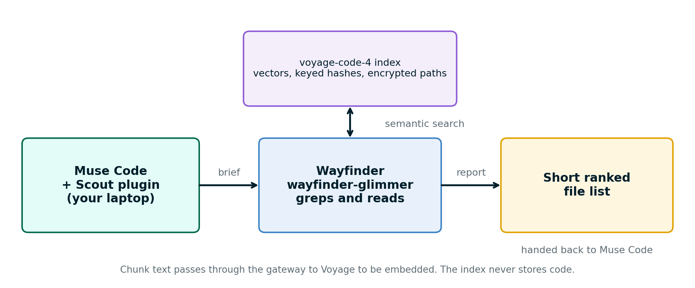

# wayfinder

An open model, post trained using Muse-Spark-Open-816B-A42B, that searches code at frontier quality.

**Built with Muse Spark Open.**

Submission to the Meta hackathon, "Build for Your World", startup track, from Voyage AI.

## What it is

- **wayfinder-qwen**: Qwen3.6-35B-A3B, post trained with LoRA SFT on 1,383 successful search trajectories written by Muse Spark Open. Open weights: [hweller1/wayfinder-qwen-35b-a3b](https://huggingface.co/hweller1/wayfinder-qwen-35b-a3b). Model card: [docs/MODEL_CARD_QWEN.md](docs/MODEL_CARD_QWEN.md).
- **Scout**: a plugin for Muse Code that hands search to Wayfinder. A hybrid search plus rerank step refines its list on every call.
- **The index**: `voyage-code-4` vectors in turbopuffer. No code is stored.

## How it works



Wayfinder searches with grep and file reads and reports files. One cascade then refines the list: hybrid search (`voyage-code-4` vectors plus BM25 on hashed identifiers, top 100 chunks rolled up to files) is merged with the model's list by reciprocal rank fusion, and Voyage rerank-3 reorders positions 6 to 40 with the instruction "Rank source files a developer must edit or test for this change".

## Results

Intervals are 95% bootstrap intervals over tasks.

**The cascade.** 200 held-out tasks, 47 repositories, 2 seeds. Recall@12 is the share of the right files in the top 12.

| List | recall@12 |
|---|---|
| Model's own list | 0.414 |
| After the merge | 0.493 |
| After the rerank | 0.531 |

The rerank adds +0.038 [+0.023, +0.054]; the whole cascade adds +0.117 [+0.095, +0.139]. Recall@5 moves from 0.336 to 0.345, which is not significant. The cascade adds about 0.4 s per search. It shows the cascade finds more of the right files in the top 12; it does not show a gain at the very top of the list.

**Coding pass rate.** 34 tasks that fail without search, 2 seeds, Opus 5.5 as the coder, network blocked, coder sees only the files the searcher returned.

| Searcher | Pass rate |
|---|---|
| No search | 0.074 |
| wayfinder-qwen with the cascade | 0.824 [0.71, 0.93] |
| Right files given | 0.971 |
| Sonnet 5.5 high, run without the cascade | 0.868 |
| GPT-6.1 Sol, run without the cascade | 0.853 |
| Agents-A1-35B, run without the cascade | 0.853 |

Search lifts the pass rate by about 0.8 over no search. The differences between searchers are not resolved. The other searchers were run on 2026-11-02 without the cascade. Full results page: [docs/results/README.md](docs/results/README.md).

**Search benchmark.** Same 200 tasks, grep arm. Reported recall is the share of right files in the model's final report. Cost is per search task.

| Model | Reported recall | Cost per task |
|---|---|---|
| wayfinder-qwen, own list | 0.415 | about $0.045 (open-price equivalent) |
| Agents-A1-35B | 0.313 | $0.113 |
| Sonnet 5.5 high | 0.529 | $0.120 |
| GPT-6.1 Sol | 0.580 | $0.062 (rate unconfirmed) |

With the cascade, wayfinder-qwen reaches recall@12 of 0.531, level with Sonnet and a little under GPT. The lists have different lengths, so this is not a like-for-like comparison. On recall@5 it trails the frontier models. Details: [docs/results/README.md](docs/results/README.md).

**Inside Muse Code.** 26 tasks, one run each, default configuration.

| | Muse Code alone | With Wayfinder |
|---|---|---|
| Cost per run | $0.342 | $0.195 |
| Muse Code input tokens | 887K | 441K |
| precision@12 | 0.366 | 0.355 |
| recall@12 | 0.590 | 0.536 |
| recall@5 | 0.449 | 0.383 |
| Median time | 80 s | 105 s |

Cost is about 43 percent lower and Muse Code reads about half the tokens. Precision@12 and recall@12 differ within noise. Recall@5 is lower with Wayfinder, and we have not tested why. Wayfinder is about 25 seconds slower in median time. The claim is cost and tokens, not better accuracy.

**Privacy.** The index holds only vectors, keyed hashes and encrypted paths and line ranges. Chunk text is sent to Voyage to be embedded, and the gateway operator can read it in transit. A security test checks that no path segment, identifier or 20-byte source window reaches the store: [scout/tests/security/test_no_plaintext.py](scout/tests/security/test_no_plaintext.py), described in [docs/scout/PRODUCT_STATUS.md](docs/scout/PRODUCT_STATUS.md). Use public code until you have confirmed Voyage's data-retention setting.

## Limits

- The Muse Code study has one run per task, so it is calibration-scale evidence.
- Wayfinder finds fewer files than Muse Code alone on some tasks. On excalidraw it did worse in 4 of 5 batch runs. It follows the wording of the task, and the right files are not always named like it.
- Wayfinder is slower in wall time.
- The demo video shows the best of five runs per task, picked after seeing them. The 26-task numbers above are the representative ones.
- The task records are not a separate file; they are inside the gated training-data trajectories (tasks drawn from public repositories only). The scorers and harnesses are in `eval/`.

## Try it

Offline tests, no keys needed:

```bash
cd scout && uv sync --frozen --extra gateway
uv run pytest -q
cd ../training && PYTHONPATH=.:../scout/src python3 -m pytest tests -q
```

Serving the model on Modal: `modal deploy deploy/modal/serve_qwen.py`, then the gateway and plugin steps in [docs/RUN.md](docs/RUN.md) (written for wayfinder-glimmer, same shape; the qwen serving notes are in [docs/MODEL_CARD_QWEN.md](docs/MODEL_CARD_QWEN.md)). Installing the Muse Code plugin: [scout/integrations/muse-code/INSTALL.md](scout/integrations/muse-code/INSTALL.md). Side-by-side demo runbook: [docs/demo.md](docs/demo.md). Both deployment kits were tested offline and have not been run from a fresh account.

## What was built during the event

The event ran October 26 to November 4, 2026.

- `scout/` descends from a repository whose history starts on October 25, 2026 (42 commits that day). Of the 408 `scout/` files here, 131 were first added on October 25, several of them empty packages.
- `training/`, `eval/` and `deploy/` are event work, as are the model, the held-out evaluations and the studies.
- The component table and the list of existing things this work uses and does not claim are in [docs/EVENT_WORK.md](docs/EVENT_WORK.md). [RELEASE_CHECKLIST.md](RELEASE_CHECKLIST.md) lists the October 25 files.

## Repository layout

| Path | What is in it |
|---|---|
| `scout/` | Client, gateway, MCP server, CLI, plugins, tests, plugin-study harness |
| `training/` | SFT recipe, rollout harness, data build, GRPO and distillation experiments ([README](training/README.md)) |
| `eval/` | Scorers, end-to-end coding study code, result summaries ([README](eval/README.md)) |
| `deploy/` | Modal and GCP serving kits |
| `docs/` | Results, model cards, demo runbook, event work, run guide |
| `licenses/`, `LICENSE`, `NOTICE` | Apache-2.0 for this code; model license files and obligations |

## Also in this repo

wayfinder-glimmer is the first model trained with the same recipe (Muse Glimmer 30B base). Its weights ([hweller1/wayfinder-glimmer-30b](https://huggingface.co/hweller1/wayfinder-glimmer-30b)) and Modal kit are kept for reproducibility. It is not part of the results above. Model card: [docs/MODEL_CARD.md](docs/MODEL_CARD.md).

## License and notices

Code: Apache-2.0 ([LICENSE](LICENSE)). wayfinder-qwen is a Muse Spark Open derivative: the license and usage policy travel with the weights, "Built with Muse Spark Open" is displayed by any product that uses the model, and Model-as-a-Service above US$20M revenue needs a Meta agreement. Agents-A1-35B (Apache-2.0) contributed 33 of 1,383 training examples. The license files are in [licenses/](licenses/) and [NOTICE](NOTICE) lists every obligation. The teacher trajectories are not published.
