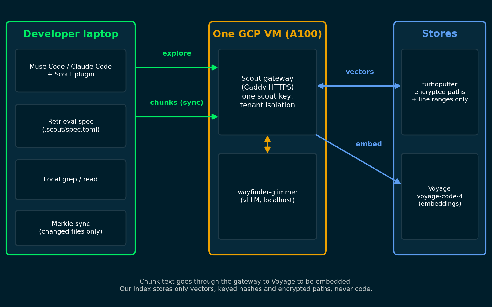

# wayfinder: an open search model and an indexed code-search subagent

**Built with Muse Spark Open.**

Submission to the Meta hackathon, "Build for Your World" track, startup track, representing Voyage AI. It has three parts that fit together:

- **wayfinder-glimmer**, Muse Glimmer 30B post-trained (LoRA SFT) to be a code-search subagent: it plans, greps and reads an unfamiliar repository, optionally queries a vector index, and returns ranked `path:start-end` ranges with reasons. Weights: [hweller1/wayfinder-glimmer-30b](https://huggingface.co/hweller1/wayfinder-glimmer-30b).
- **Scout**, the plugin, client and gateway around it. A plugin for Muse Code and Claude Code hands "explore" tasks to a subagent that searches with local `grep` and `read`, plus a semantic index of `voyage-code-4` vectors. The index is built from the developer's laptop and kept in turbopuffer; one gateway holds every vendor key.
- **An evaluation harness and the results**, including an end-to-end study of whether a coding agent given only the files that search returned actually fixes the task.

## What it shows

**1. Outcome: an open Meta model gets a coding agent to the same pass rate as Claude Sonnet 5.5.** On 34 coding tasks that fail without search (8 repos, 2 seeds), an Opus 5.5 coder that could only open the files search returned passed **0.07 with no search, 0.87 with wayfinder-glimmer, and 0.87 with Sonnet 5.5 (high) as the searcher**. Source: [docs/results/e2e_final_results.md](docs/results/e2e_final_results.md) (the "v4" set). Read it with these caveats: 16 of the 34 tasks come from one repository (karalang/kara), so the effective sample is smaller than 34; the differences between searchers are unresolved (minimum detectable effect about 0.06 to 0.09, observed difference at most 0.015); and the stricter primary task set reached only 4 usable tasks, on which nothing separated from "no search".

**2. Cost: the parent agent reads less.** In Muse Code with Scout, the parent read **397K input tokens per task against 864K for stock Muse Code**, and the run cost about **$0.24 against $0.33** (26 tasks, 1 seed, a list-price estimate from run tokens, not an invoice). Source: [docs/results/muse_scout_results.md](docs/results/muse_scout_results.md). The $0.24 does not include the GPU that serves wayfinder-glimmer.

**3. Privacy: our index never stores your code.** The index (turbopuffer) holds only `voyage-code-4` vectors, keyed hashes and encrypted paths and line ranges, never code. A security test runs the full client flow against a recording store and checks that no path segment, identifier or 20-byte source window reaches it, and that three planted leaks are caught: [scout/tests/security/test_no_plaintext.py](scout/tests/security/test_no_plaintext.py). Source: [docs/scout/PRODUCT_STATUS.md](docs/scout/PRODUCT_STATUS.md). The trust boundary matters, so read it: chunk text does pass through the gateway and on to Voyage's embedding API to be embedded, and the gateway operator can read it in transit. We make no claim that Voyage retains nothing, and its data-retention setting for the account that embeds the code applies to what it receives. Embeddings can be partly inverted, and encrypting paths deterministically shows which rows share a path segment. Use public code until you have confirmed the retention setting.

## Architecture



The laptop chunks files, encrypts paths and line ranges, and hashes identifiers; the gateway embeds chunk text with `voyage-code-4` and writes vectors and ciphertext to turbopuffer; searches combine local `grep`/`read` on the laptop with semantic search over the index. The gateway also runs the chat loop against wayfinder-glimmer, served by vLLM on the same VM in the demo deployment ([deploy/gcp](deploy/gcp)). One scout key authenticates a client; tenants are isolated by key.

## What was built during the event and what was not

The event ran October 26 to November 4, 2026. Only work from the event counts, so this section says what existed the day before. `scout/` descends from a repository whose history starts on October 25, 2026: 42 commits that day, then 167 more from October 26 to November 1 (this release keeps part of that tree). Of the 408 `scout/` files in this repository, 131 were first added on October 25. The table is derived from `git log` of that repository: first-add date per file, and commits and lines changed (added plus deleted, in the files kept here) from October 26 on. "Files" is files kept in this release; "line counts" compare the October 25 snapshot with the release.

| Component (`scout/`) | State on Oct 25 | Work during the event |
|---|---|---|
| Wire schemas (`schema/v1`) | 38 of 40 JSON schemas generated | 2 added; 5 commits, 214 lines changed |
| Typed contracts, port interfaces, local file layer (`grep`, `glob`, `read_file`, ignore rules), `app.py` facade (21 files) | All 21 files existed (about 1,400 lines) | Small edits: 13 commits, 308 lines changed |
| Explore loop and prompts (`core/explore`, 12 files) | 9 files, about 790 lines: loop, tools, profiles, budget, candidates, render, two prompts | 3 files added (`backfill.py`, `semantic.py`, `spec.py`); 6 commits, 859 lines changed; about 1,550 lines now |
| Adapters (26 files) | 12 files, about 540 lines: in-memory fakes for chat, clock, filesystem, gateway and store, plus empty packages for the Voyage, turbopuffer, keychain, OpenAI-compatible chat and gateway HTTP adapters | The real adapters: 17 commits, 2,443 lines changed; about 2,760 lines now |
| Encryption (`core/crypto`, 8 files) | An empty package | Written during the event: keys, path and row encryption, tokens, scope, MinHash; about 880 lines |
| Sync engine and teammate seed (`core/sync`, 8 files) | An empty package | Written during the event; about 2,320 lines |
| Gateway service (`core/service`, 10 files) | An empty package | Written during the event: auth, tenants, indexing, search, chat; about 1,710 lines |
| CLI, daemon, MCP and gateway HTTP surfaces, SDK (15 files) | Empty packages for the four surfaces, plus a 167-line `sdk.py` | Written during the event: 12 commits, 2,013 lines changed; about 2,130 lines now |
| Wiring, package root and demo runtime (11 files) | `wiring.py` (83 lines) and the package init | The 9-file demo runtime added; `wiring.py` grew to 551 lines; 18 commits, 1,635 lines changed |
| Muse Code and Claude Code plugins (`integrations/`, 53 files) | None | All event work: 22 commits, 6,564 lines changed |
| Evaluation harness (`eval/harness`, 16 files) | None | All event work: 17 commits, 2,851 lines changed |
| Tests (174 files) | 35 files, about 2,850 lines: unit tests for the contracts, explore loop, fakes, local tools and wire schemas, a proof-of-concept contract test, the small fixture repository | 139 files added, including the security, conformance and live suites, the declaration fixtures and the service, sync and crypto tests; 95 commits, 36,452 lines changed (fixtures and golden files are about 10,000 of those) |
| Build, scripts, ops, deploy (14 files) | `Makefile`, `pyproject.toml`, `uv.lock`, schema generator, namespace janitor | 9 files added, including the Modal gateway app: 20 commits, 1,361 lines changed |

Everything outside `scout/` is event work: all of `training/` and `eval/` (their history starts on October 26) and the GCP deployment kit in [deploy/gcp](deploy/gcp). The model, the training recipe, the held-out evaluations, the end-to-end study and the Muse Code study are event work. [RELEASE_CHECKLIST.md](RELEASE_CHECKLIST.md) lists the October 25 files.

**Existing things this work uses and does not claim.** Muse Glimmer 30B (the base model) and Muse Spark Open (the teacher), Agents-A1-35B and its public transcripts, the `voyage-code-4` embedding model and API, turbopuffer, vLLM, Muse Code and Claude Code, and a pre-existing private benchmark of coding tasks from public repositories, from which the training pool and the held-out sets were drawn. Some evaluation and mining scripts here are adapted from tooling for that benchmark. The benchmark, its task records, and the teacher trajectories are not included.

## Repository layout

| Path | What is in it |
|---|---|
| `scout/` | The Scout client, gateway, MCP server, CLI, Claude Code and Muse Code plugins, wire schemas, tests (offline suite plus live tests that need keys), and the evaluation harness for the plugin studies (`scout/eval/harness`) |
| `training/` | The SFT recipe for wayfinder-glimmer (`wayfinder/sft`), the rollout harness and rubric (`wayfinder/rollout`, `wayfinder/rubric.py`), data-build scripts, the GRPO and on-policy-distillation experiments (`wayfinder/grpo`, `wayfinder/opd`), the Modal serving app used for the evaluations, model release scripts, and tests. [training/README.md](training/README.md) |
| `eval/` | Scorers, the end-to-end coding study code (`eval/e2e`), and result summaries (`eval/results`), with no raw transcripts. [eval/README.md](eval/README.md) |
| `deploy/gcp/` | wayfinder-glimmer and the Scout gateway on one A100 VM: scripts, systemd units, Caddy, secrets handling, health checks, tests |
| `docs/` | `docs/results/` (three result write-ups), `docs/scout/` (product status and the Claude Code study), `docs/demo.md` (the Muse Code side-by-side runbook), `docs/MODEL_CARD.md` |
| `licenses/`, `LICENSE`, `NOTICE` | Apache-2.0 for this code; Muse Glimmer and Muse Spark Open license files and obligations |

## How to run

Everything below that touches a cloud service needs your own keys. Nothing needs Modal.

**Tests (offline).**

```bash
cd scout && uv sync --frozen --extra gateway
uv run pytest -q                                            # contract, unit, conformance and security tests; no network
uv run python -m pytest ../deploy/gcp/tests -q              # the GCP kit's offline checks
cd ../training && PYTHONPATH=.:../scout/src python3 -m pytest tests -q
```

**Serve the model and the gateway** on one A100 80 GB VM: [deploy/gcp/README.md](deploy/gcp/README.md). It installs vLLM 0.32.0, serves `hweller1/wayfinder-glimmer-30b` as `wayfinder-glimmer` with the `muse_glimmer` tool-call and reasoning parsers, runs the gateway under uvicorn behind Caddy (HTTPS), and keeps vLLM on localhost. To serve the model alone: the command in [docs/MODEL_CARD.md](docs/MODEL_CARD.md).

**Use Scout from Muse Code or Claude Code.** Set `SCOUT_GATEWAY_URL` to your gateway and `scout login` with a key from `gateway_vm.py issue-key`; then `scout sync --wait` in a checkout and install the plugin: [scout/integrations/muse-code/INSTALL.md](scout/integrations/muse-code/INSTALL.md), [scout/integrations/claude-code/README.md](scout/integrations/claude-code/README.md). The side-by-side demo is [docs/demo.md](docs/demo.md); the pane and VM scripts are `scout/scripts/demo_panes.sh` and `demo_warm.sh`.

**Train and evaluate.** [training/README.md](training/README.md) (the recipe, and how to regenerate the teacher data) and [eval/README.md](eval/README.md).

## Results

All intervals are 95% bootstrap intervals over tasks unless stated. Details and caveats are in the linked documents.

**End-to-end: pass rate of a coding agent handed the searcher's files** ([docs/results/e2e_final_results.md](docs/results/e2e_final_results.md)). Opus 5.5 coder with no search tools; held-out tests absent from its sandbox. Tasks were selected because the coder fails without search.

| Searcher | Secondary set "v4": 34 tasks, 8 repos, 68 runs | Primary set: 4 tasks, 8 runs |
|---|---|---|
| none | 0.074 [0.02, 0.15] | 0.125 [0.00, 0.38] |
| wayfinder-glimmer | 0.868 [0.75, 0.96] | 0.250 [0.00, 0.75] |
| Agents-A1-35B | 0.853 [0.74, 0.96] | 0.250 [0.00, 0.75] |
| Sonnet 5.5 (high) | 0.868 [0.75, 0.96] | 0.375 [0.00, 0.75] |
| GPT-6.1 Sol | 0.853 [0.74, 0.94] | 0.125 [0.00, 0.38] |
| gold files (ceiling) | 0.971 [0.93, 1.00] | 0.875 [0.63, 1.00] |

The two sets are not pooled. On v4 every searcher lifts the pass rate by about 0.8 over no search, and that survives a repository-cluster bootstrap; searchers are not separated from each other. On the primary set (stricter filters, only 4 tasks survived) nothing is significant.

**Held-out retrieval: 200 tasks from 47 repositories never seen in training** ([docs/results/heldout_hard_v1_frontier.md](docs/results/heldout_hard_v1_frontier.md)). Reported recall is the share of gold files in the final report (at most 12), grep arm; "semantic" adds the voyage-code-4 index.

| Model | Reported recall, grep | Reported recall, semantic | Turns per task (grep) |
|---|---|---|---|
| wayfinder-glimmer | 0.452 [0.412, 0.491] | 0.446 [0.406, 0.484] | 9.9 |
| Agents-A1-35B | 0.313 [0.280, 0.348] | 0.352 [0.319, 0.387] | 34.1 |
| Sonnet 5.5 (high) | 0.529 [0.491, 0.567] | 0.518 [0.480, 0.556] | 7.5 |
| GPT-6.1 Sol | 0.580 [0.541, 0.619] | 0.576 [0.538, 0.614] | 7.8 |

wayfinder-glimmer closes about two thirds of the gap between Agents-A1-35B and Sonnet 5.5, and stays behind both frontier models.

**Muse Code with and without Scout** ([docs/results/muse_scout_results.md](docs/results/muse_scout_results.md)). 26 tasks, 1 seed, Muse's default parent model.

| Arm | recall@12 | precision@12 | files reported | parent input tokens | wall median s | Muse $/run (list-price estimate) |
|---|---|---|---|---|---|---|
| Muse Code, stock | 0.600 | 0.381 | 15.0 | 864K | 65 | 0.334 |
| Muse Code + spec, built-in search | 0.566 | 0.333 | 16.7 | n/a | 77 | 0.249 |
| Muse Code + spec + Scout (wayfinder-glimmer) | 0.525 | 0.384 | 10.5 | 397K | 189 | 0.237 |

**Other results.** On the pre-registered test split (152 tasks, 31 repositories), wayfinder-glimmer reached 0.519 reported recall against 0.439 for Agents-A1-35B and 0.428 for the untrained base. Summary files for this and the other evaluations are in `eval/results/`; the write-ups for the test split, the languages with little training data, the SFT iterations and the GRPO experiments are not included.

## Limitations

- **Scout is slow.** A Scout search with wayfinder-glimmer takes about 2 to 3 minutes (median 126 s for the `explore` call and 189 s for the whole Muse Code session, on a warm H100 at width 2), against about 1 minute (65 s) for stock Muse Code. On Modal a cold start from zero added 2 to 3 minutes; on the GCP VM, boot plus model load takes 3 to 8 minutes. An A100, as in the GCP kit, is slower than the H100 these numbers come from.
- **Scout does not find more files than Muse Code's own search.** On the 26-task calibration, recall@12 was lower with Scout: -0.075 [-0.140, -0.010] against stock Muse Code. In the Claude Code study (50 tasks) built-in Explore also retrieved more than Scout (-0.086 [-0.153, -0.021]) and was several times faster ([docs/scout/PRODUCT_STATUS.md](docs/scout/PRODUCT_STATUS.md)). What Scout changed is where the work happens: the parent reads fewer tokens.
- **Held-out retrieval is behind the frontier.** wayfinder-glimmer 0.45 reported recall against Sonnet 5.5 (high) 0.53, GPT-6.1 Sol 0.58 and Agents-A1-35B 0.31, on 200 tasks from 47 repositories never seen in training. The semantic index added no recall for this model.
- **The outcome result is narrow.** One coder model, 34 tasks dominated by one repository, searchers near the ceiling, and a stricter primary set that yielded 4 tasks. It supports "any searcher helps a lot when the coder cannot find the code unaided", not a ranking of searchers.
- **One training run, one seed.** The model card lists the remaining caveats (English only, public repositories only, thin Swift, C# and Java/Kotlin data, license of the underlying code not cleared task by task).
- **Not rehearsed on GCP.** The deployment kit was written and tested offline. The demo numbers were measured on Modal H100s.
- **Task manifests are not included.** The training and evaluation task records derive from a pre-event private benchmark; the scorers and harnesses are here, the records are not. `eval/results/eval_repos_license.csv` lists the repositories and their licenses.

## License and notices

Code: Apache-2.0 ([LICENSE](LICENSE)). wayfinder-glimmer is a Muse Spark Open derivative: Muse Glimmer 30B is Apache-2.0 with Meta's usage policy, and the Muse Spark Open license adds conditions (the license and usage policy travel with the weights, "Built with Muse Spark Open" is displayed by any product that uses the model, and Model-as-a-Service above US$20M revenue needs a Meta agreement). Agents-A1-35B (Apache-2.0) contributed 33 of 1,383 training examples. The license files are in [licenses/](licenses/) and [NOTICE](NOTICE) lists every obligation. The Spark Open teacher trajectories used for training are not published.
