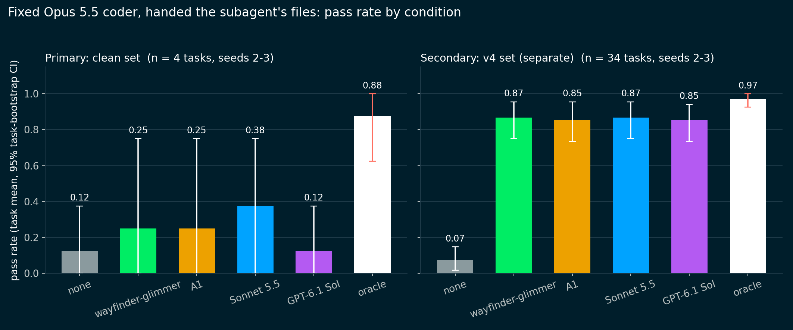

# Final E2E coding eval: results

Run 2026-10-30 to 10-31 under `docs/e2e_final_plan.md` (pre-registered, including Addendum 1). The question is whether a better search subagent raises the pass rate of a fixed coder on tasks it cannot solve without finding the code. The design is the handed-files design of `docs/e2e_eval.md`: Opus 5.5 (medium, via an LLM API gateway) has no search tools, `read_file` opens only the files the subagent returned, and the held-out tests are absent from its sandbox and asserted so. The diff is scored in a separate Modal sandbox against the held-out tests (pass means every fail-to-pass test passes and no regression-set test fails). Code is in `eval/e2e/` (`final_*.py`, `run_coder.py`, `analyze_final.py`), rows are in `eval/e2e/runs/final/`, and the figure is `docs/figures/s12_e2e.png`. Raw transcripts sit next to the rows and are gitignored.

## Headline

The primary clean set reached only **4 headroom tasks** (2 Go, 2 TypeScript). At that size nothing is resolved: no subagent differs from `none` after Holm correction, and the minimum detectable effects are 0.35 or larger. The secondary v4 set (34 headroom tasks) shows a large, unambiguous lift from any subagent over no search (about +0.8) and no resolvable difference between the four subagents. The v4 set is separate and is never pooled with the clean set. It is dominated by one repository (16 of 34 tasks are from `karalang/kara`), so its effective sample is smaller than 34, and the comparison among subagents there sits close to the oracle ceiling (0.97).

## Funnel

Counts per stage and language. Structural filter: the gold patch modifies at least one existing non-test file. Probe: Opus 5.5 with the repo name and issue, no tools, flagged if it names at least half of the gold non-test paths. Screen: `none` fails on seeds 0 and 1 and `oracle` passes on seed 0.

| Set | Language | In | Structural drop | Probe drop | Screen drop (none passes) | Screen drop (oracle fails) | Headroom |
|---|---|---|---|---|---|---|---|
| clean (primary) | Go | 17 | 0 | 0 | 4 | 11 | 2 |
| clean (primary) | TypeScript | 6 | 0 | 0 | 3 | 1 | 2 |
| v4 (secondary) | Go | 17 | 0 | 9 | 0 | 0 | 8 |
| v4 (secondary) | Python | 49 | 0 | 38 | 2 | 0 | 9 |
| v4 (secondary) | Rust | 17 | 0 | 0 | 0 | 0 | 17 |

The clean set arrives with the structural filter and the probe already applied by the task builder (its build funnel: 167 gated, 64 with a valid issue, 61 scorer-checked, 32 flagged as memorised, 1 new-files-only, 5 excluded as trained-on repos, 23 kept). The probe field on each task was reused as recorded, and every clean task has at least one modified existing file. The oracle failure rate on the clean Go tasks is high (11 of 17). Those tasks have large gold patches that the coder frequently fails to complete even when handed every gold file, so they cannot show headroom.

### v4 probe result

The probe flagged **47 of 83** v4 tasks as memorised (Python 38 of 49, Go 9 of 17, Rust 0 of 17), leaving 36. All 36 modify existing files. This is a finding on its own: most of the earlier v4 Python set can be located from the issue text and the repo name without any search. It is the reason the v4 set was probed before any subagent condition ran.

### Caveat on the probe

Across the clean-set candidates the probe flagged 211 of 250 (84%) as memorised. The probe lets Opus list up to about 12 paths, so naming at least half of the gold paths can come from inferring a conventional repository layout as well as from memorising the repository. The probe therefore excludes tasks whose files are nameable without searching, in either case. That matches the author's eligibility intent, but the probe does not prove memorisation, and a flagged task should not be read as evidence of training-data leakage.

## v4 screen reuse (declared procedural choice)

The v4 blind-screen rows (`none` seeds 0 and 1, `oracle` seed 0) were copied from the earlier v4 runs (`runs_v4/`, written 2026-10-27) rather than rerun, for the 36 probe survivors. One task (`temporal-ef607d`) had no seed-1 `none` row and was run now. The reuse is valid only if the protocol is identical, and it was checked (`eval/e2e/runs/final/v4_reuse_check.md`):

- Coder: all 105 reused rows record `opus-5.5-medium`, the same the LLM gateway backend id. The caps (60 tool calls, 400k prompt tokens) are unchanged in code, and 104 of 105 rows ended by `done`.
- Issue text: the `task_text` in every reused row equals `issue_text` in `tasks_v4.json` (105 of 105).
- Handed files: `condition_block` and `allowlist_for` for `none` and `oracle` are unchanged between the old commit and now. The only code differences are the extra subagent conditions, the manifest loader and the spend/disk guard.
- Sandbox and scorer: the diff of `modal_sandbox.py`, `score.py` and `gate.py` against the old commit contains only TypeScript branches and an app-name override. The Go, Python and Rust paths, the cache volume and the fail-to-pass plus regression-set rule are the same.

## Results

Unit is the task, with seeds 2 and 3 averaged within task. Intervals are 95% task-bootstrap (10,000 resamples). The primary test is the exact paired sign-flip test on per-task differences from `none` (two-sided; Monte Carlo with 100,000 draws when more than 20 tasks have a nonzero difference), Holm-corrected over the four contrasts.

### Pass rate

| Condition | Primary clean (n = 4 tasks, 8 runs) | Secondary v4 (n = 34 tasks, 68 runs) |
|---|---|---|
| none | 0.125 [0.00, 0.38] (1/8) | 0.074 [0.02, 0.15] (5/68) |
| oracle | 0.875 [0.63, 1.00] (7/8) | 0.971 [0.93, 1.00] (66/68) |
| wayfinder-glimmer | 0.250 [0.00, 0.75] (2/8) | 0.868 [0.75, 0.96] (59/68) |
| A1 | 0.250 [0.00, 0.75] (2/8) | 0.853 [0.74, 0.96] (58/68) |
| Sonnet 5.5 | 0.375 [0.00, 0.75] (3/8) | 0.868 [0.75, 0.96] (59/68) |
| GPT-6.1 Sol | 0.125 [0.00, 0.38] (1/8) | 0.853 [0.74, 0.94] (58/68) |

The `none` rate above zero on the headroom tasks comes from seeds 2 and 3, which are fresh samples after tasks were selected on seeds 0 and 1. Some regression toward the mean is expected.

### Primary family: each subagent minus none

| Contrast | Clean diff [95% CI] | p | Holm p | v4 diff [95% CI] | p | Holm p |
|---|---|---|---|---|---|---|
| wayfinder-glimmer - none | +0.125 [0.00, +0.38] | 1.00 | 1.00 | +0.794 [+0.66, +0.91] | < 1e-4 | < 1e-4 |
| A1 - none | +0.125 [0.00, +0.38] | 1.00 | 1.00 | +0.779 [+0.63, +0.91] | < 1e-4 | < 1e-4 |
| Sonnet - none | +0.250 [0.00, +0.75] | 1.00 | 1.00 | +0.794 [+0.66, +0.91] | < 1e-4 | < 1e-4 |
| GPT - none | 0.000 [0.00, 0.00] | 1.00 | 1.00 | +0.779 [+0.63, +0.90] | < 1e-4 | < 1e-4 |

On the primary clean set no contrast is significant, as expected at n = 4 (the smallest attainable two-sided exact p with 4 tasks is 0.125). The v4 result is not the plan's primary result, because v4 is the secondary set; it is reported with the same table for completeness.

### Secondary contrasts (descriptive), with MDE at the achieved n

MDE is the paired minimum detectable effect at the achieved n (two-sided alpha 0.05, power 0.8), computed from the observed standard deviation of the per-task differences. A difference below the MDE is "not resolved at this n", not "no difference".

| Contrast | Clean diff [CI] | MDE | v4 diff [CI] | MDE |
|---|---|---|---|---|
| wayfinder-glimmer - A1 | 0.000 [0.00, 0.00] | 0.00 | +0.015 [-0.04, +0.09] | 0.093 |
| Sonnet - wayfinder-glimmer | +0.125 [-0.38, +0.75] | 0.881 | 0.000 [-0.04, +0.04] | 0.059 |
| GPT - wayfinder-glimmer | -0.125 [-0.38, 0.00] | 0.350 | -0.015 [-0.07, +0.04] | 0.093 |
| oracle - wayfinder-glimmer | +0.625 [+0.25, +1.00] | 0.671 | +0.103 [+0.02, +0.21] | 0.142 |
| oracle - A1 | +0.625 [+0.25, +1.00] | 0.671 | +0.118 [+0.04, +0.22] | 0.133 |
| oracle - Sonnet | +0.500 [-0.13, +1.00] | 0.991 | +0.103 [+0.02, +0.21] | 0.142 |
| oracle - GPT | +0.750 [+0.50, +1.00] | 0.404 | +0.118 [+0.03, +0.22] | 0.133 |

On the clean set the MDEs (0.35 to 0.99) exceed every observed difference, so none of these contrasts is resolved. On v4 the subagent-versus-subagent differences (at most 0.015) are well inside their MDEs of 0.06 to 0.09, so the data support "no difference larger than about 0.06 to 0.09 between these subagents on these tasks", with the caveat that the 34 tasks are heavily clustered in one repository and that the ceiling is near 1. The oracle-minus-subagent gaps on v4 (+0.10 to +0.12, with intervals above zero at the unadjusted level) are about the size of their MDEs, so they are borderline.

### Handed files

Gold recall is file-level against the gold non-test source files that exist at the base commit, for the first-listed files the coder was handed and allowed to open.

| Subagent | Clean: mean gold recall | Clean: all gold handed | v4: mean gold recall | v4: all gold handed | v4: pass if all gold handed | v4: pass if a gold file missing |
|---|---|---|---|---|---|---|
| wayfinder-glimmer | 0.45 | 0/8 | 0.75 | 0.43 | 25/29 | 34/39 |
| A1 | 0.38 | 0/8 | 0.65 | 0.32 | 17/22 | 41/46 |
| Sonnet 5.5 | 0.48 | 0/8 | 0.84 | 0.63 | 36/43 | 23/25 |
| GPT-6.1 Sol | 0.50 | 1/8 | 0.85 | 0.63 | 35/43 | 23/25 |

Frontier subagents hand over more of the gold set (recall 0.84 to 0.85 against 0.65 to 0.75 on v4), and the coder still passes often when a gold file is missing (v4, pooled over the four subagents: 113 of 137 runs, 82%, with every gold file handed; 121 of 135 runs, 90%, with one missing), so file recall is a weak predictor of passing here. The coder often finds the missing file's role from the handed files and the issue. On the clean set the subagents handed every gold file in only 1 of 32 runs, so the by-all-gold split is empty.

### Robustness: all oracle-solvable tasks

The plan calls for the same contrasts on all oracle-solvable tasks regardless of the blind screen. The reported runs exist only on headroom tasks (seeds 2 and 3 were run only there, to hold the the LLM gateway and Modal caps), so this robustness analysis could not be run on additional tasks and is not reported. This is a deviation from the plan: the tasks dropped because `none` passed the screen (7 clean, 2 v4) have no subagent rows.

## Cost

| Item | Amount |
|---|---|
| Modal sandboxes (CPU) | about $17 recorded in row fields, excluding the reused v4 screen rows |
| Modal serving (wayfinder-glimmer, A1 on H100, scaled to zero after use) | not metered per container here; estimated from run wall time at about $10 to $15 |
| Voyage indexing (repo@commits of the first 11 clean tasks, the v4 headroom commits, and later clean headroom commits) | about $9.7 of embeddings at the $0.18 per million token estimate ($3.78 for the first 11 clean tasks, $5.92 for the rest), logged in `artifacts/index_costs/final_e2e_*`. This is Voyage spend, not Modal GPU |

## Deviations and caveats

- The primary headroom n is 4, far below the 50 target. Eligibility did not change, and the result is reported at the size reached with its MDE, as the plan requires.
- The task builder delivered 11 clean tasks first and extended the file to 23 later. The first 11 were screened and (where headroom) run before the extension, and the 12 added tasks went through the same pipeline.
- v4 reuse of earlier screen rows, and the v4 task clustering in `kara` (16 of 34), are described above.
- A1 returned `UPSTREAM_TIMEOUT` on 9 of 68 first-pass v4 rollouts at 24-way concurrency; those were rerun at concurrency 10 and the reruns are the rows reported. One wayfinder-glimmer clean-set search run was lost to a Modal preemption and rerun. These are infrastructure retries, not selection.
- The search conditions run on the 40-turn scout loop with grep and semantic search; the semantic index was present for every task (state ready, coverage 1.0). Sonnet and GPT seeds only label the rows (the API does not take a seed).
- A killed batch of coder shards and an accidental unscoped launch (stopped within seconds, no rows or spend recorded for non-headroom tasks) are in the logs under `artifacts/ops/e2e_final_*`.
- Seeds 0 and 1 were screening only and are not reported as results.

## Coordinator robustness check (2026-10-30 23:10 PT, post hoc, descriptive)

The v4 headroom set is concentrated: 34 tasks come from 8 repos, and 16 of them from `karalang/kara`. Task-level CIs therefore overstate precision. Repo-cluster bootstrap (resample the 8 repos, 5,000 draws) for each subagent minus `none` on pass rate: wayfinder-glimmer [+0.53, +0.89], A1 [+0.44, +0.90], Sonnet [+0.50, +0.89], GPT [+0.47, +0.91]. All exclude zero, so the subagent-over-no-search lift survives clustering. Excluding kara (18 tasks, 7 repos): none 0.14, wayfinder-glimmer 0.83, A1 0.78, Sonnet 0.83, GPT 0.78, oracle 0.97. The ordering is unchanged and the between-subagent gaps stay unresolved. Effective n for any repo-level claim is about 8.
